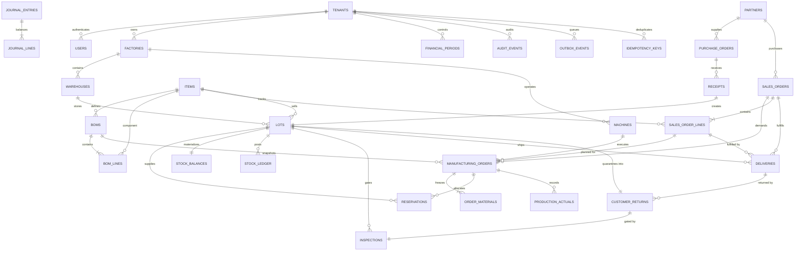
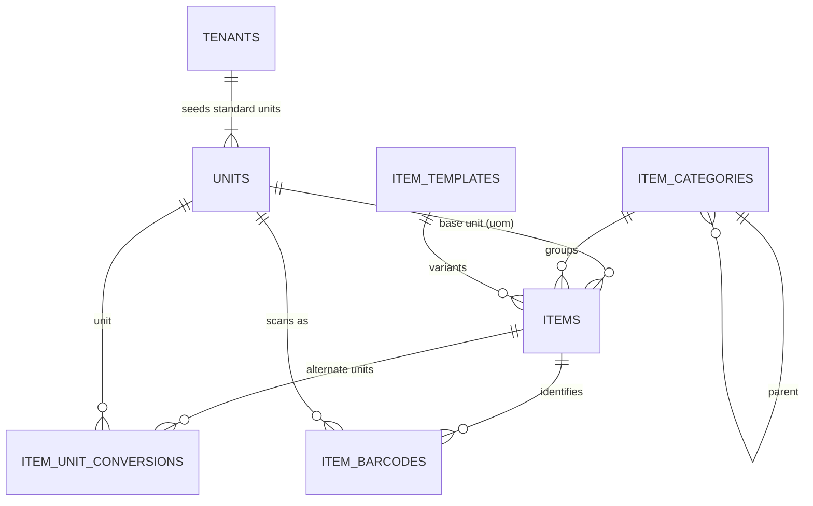
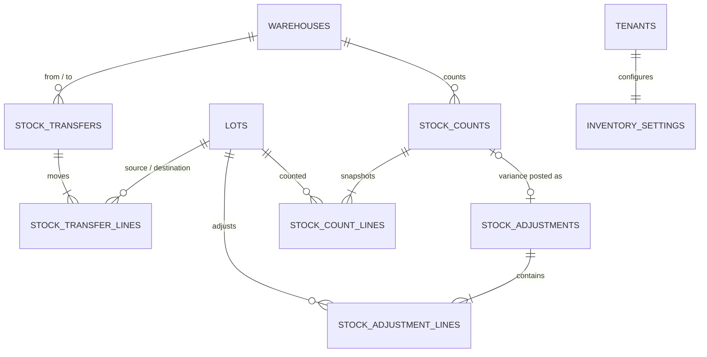
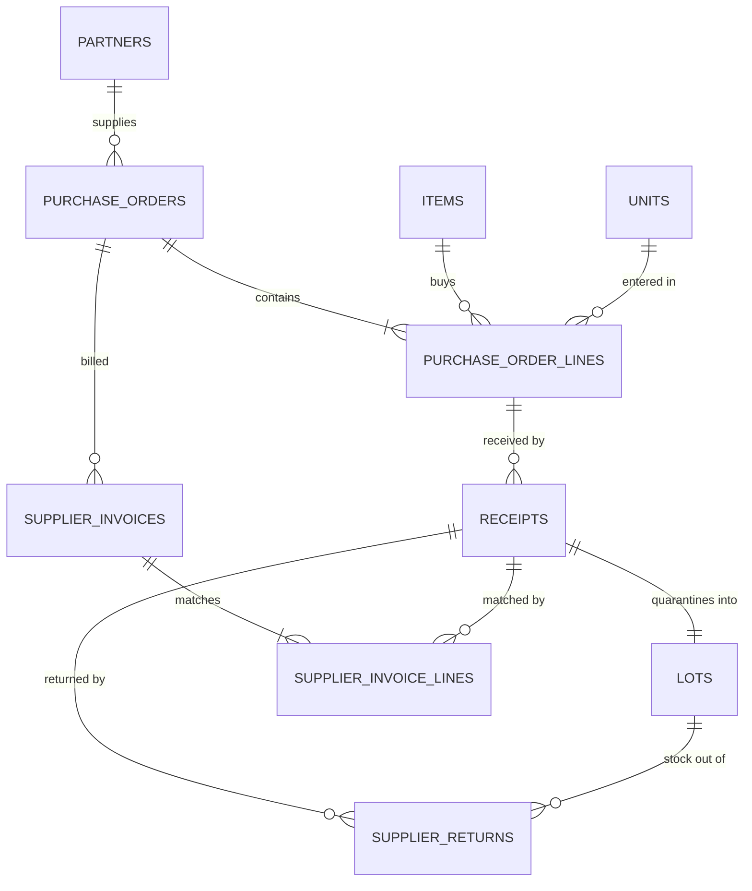
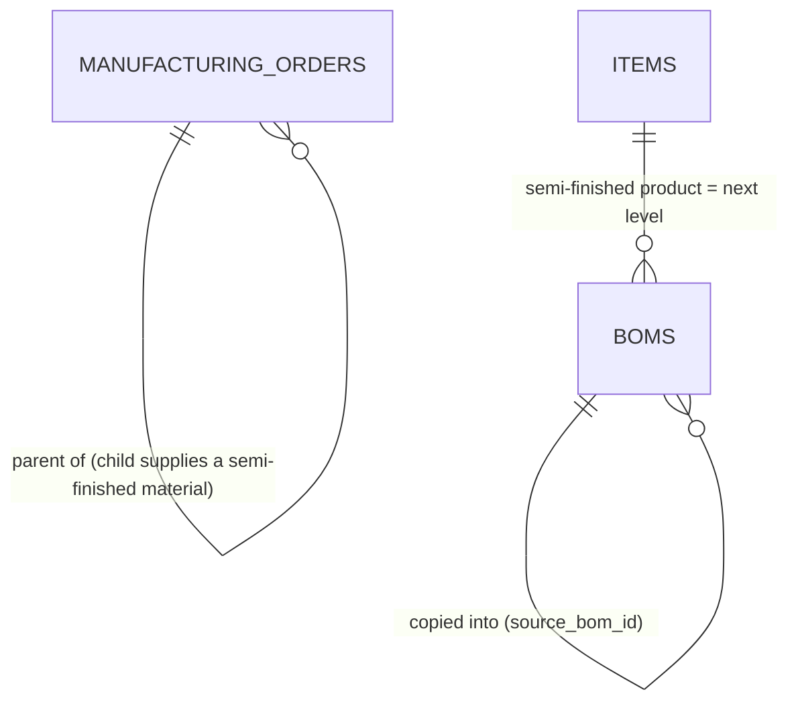
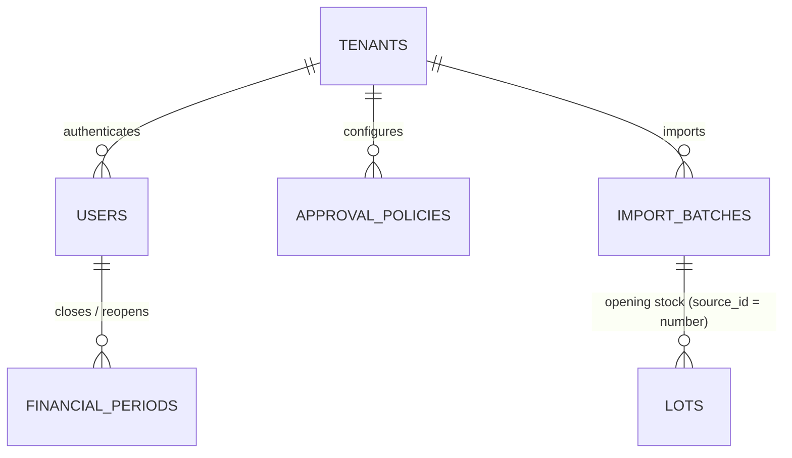

# Implemented data model

Migrations: `V1__manufacturing_core.sql`, `V2__approved_bom_integrity.sql`, `V3__sales_documents_partners_returns.sql`, `V4__item_master.sql` (item master; see below), `V5__inventory_operations.sql` (inventory operations, below), `V6__procurement_documents.sql` (procurement documents, below), `V7__multi_level_bom_planning.sql` (multi-level BOMs and parent/child orders, below), `V8__administration.sql` (administration, below). Primary IDs are UUID strings except readable demonstration master IDs. Every tenant-owned table carries `tenant_id`; references use owner/id composites where operational records cross domains. Tenant-scoped document/SKU/lot/BOM revision uniqueness prevents duplicates.

### Sales documents, partners and customer returns (V3)

- `partners` gains `phone`, `billing_address`, `shipping_address`, `tax_id`, `credit_limit` (customers only, `CHECK`), `active`, `created_at`, `updated_at`. The `partner_must_be_active()` trigger (`BEFORE INSERT` on `purchase_orders`, `BEFORE INSERT OR UPDATE OF customer_id` on `sales_orders`) rejects inactive partners on new documents with SQLSTATE 23514 (HTTP 409).
- `sales_orders` is a document header: `customer_reference`, `notes`, `subtotal`/`discount_total`/`total` (maintained from the lines), `status` ∈ `DRAFT, CONFIRMED, PARTIAL, DELIVERED, CLOSED, CANCELLED` (default `DRAFT`), `status_reason` (cancel/close-short reason), `created_by`, `confirmed_by/at`, `closed_by/at`, `updated_at`. `due_date` is the required-by date. The single-item columns `product_id`, `quantity`, `unit_price`, `delivered` were removed; their values moved to line 1.
- `sales_order_lines`: `line_no` (unique per order), `product_id`, `quantity > 0`, `unit_price ≥ 0`, `discount_pct` 0–100, `line_total` (generated: `round(quantity × unit_price × (100 − discount) / 100, 6)`), `delivered ≤ quantity`, `returned ≤ delivered`. `UNIQUE(tenant_id, sales_order_id, id)` lets children prove a line belongs to their order.
- `deliveries` gains `sales_order_line_id`, `revenue_amount` and `cost_amount` (the posted revenue and COGS of that delivery), `returned ≤ quantity`, `created_by`. `manufacturing_orders` gains `sales_order_line_id`. Both use a composite foreign key `(tenant_id, sales_order_id, sales_order_line_id)` → `sales_order_lines(tenant_id, sales_order_id, id)`, so a line always belongs to the referenced order (nullable: make-to-stock orders have neither).
- `customer_returns` (posted history, `customer_returns_immutable` trigger): `number` (also the quarantine lot number and journal reference), `delivery_id`, `sales_order_id`, `sales_order_line_id`, `lot_id` (the new `QUARANTINE` lot, `source_type = 'CUSTOMER_RETURN'`), `inspection_id` (type `RETURN`), `quantity`, `unit_cost`, `cost_amount`, `credit_amount`, `reason`, `created_by`. The return status shown to users is derived from the inspection: pending → awaiting QC, passed → restocked, failed → rejected (held, value retained).
- Migration of existing data: each single-item order becomes a header plus line 1 (same product, quantity, price, delivered), header totals are computed, existing deliveries and manufacturing orders get the line id, delivery revenue is `round(quantity × price, 6)` and delivery cost is taken from the matching posted `CUSTOMER_DISPATCH` ledger row (lot unit cost as fallback). Posted ledger/journal/audit rows are untouched.
- Indexes: `sales_orders(tenant_id, created_at DESC, id DESC)` (keyset list), `(tenant_id, status, created_at DESC)`, `(tenant_id, customer_id)`; `sales_order_lines(tenant_id, product_id)`; `deliveries(tenant_id, sales_order_id, created_at)`; `customer_returns` by order and delivery; `partners(tenant_id, type, active, name)`; `manufacturing_orders(tenant_id, sales_order_line_id)`; `audit_events(tenant_id, reference, created_at)` for document activity feeds.

## Item master (V4)

| Table / change | Purpose and rules |
|---|---|
| `units` (PK `tenant_id, code`) | Tenant units of measure: `kind` MASS/VOLUME/LENGTH/AREA/COUNT/PACKAGE, `decimals` 0–6 (quantity precision and the rounding scale of conversions), optional `ratio` to the kind's reference unit (kg, l, m, m², pcs) for fixed conversions such as g→kg; PACKAGE units (box, bag, roll…) have no ratio. The trigger `tenant_default_units` (AFTER INSERT ON tenants) seeds 15 standard units for every new tenant; V4 seeded them for existing tenants. Codes are unique case-insensitively. A unit's `decimals` is fixed once items, conversions, barcodes or families use it. |
| `items` (altered) | `uom` now references `units(tenant_id, code)` (the `kg/pcs` CHECK is gone); `type` adds `SEMI_FINISHED`; new `description`, `category_id`, `reorder_qty`, `lead_time_days`, `template_id` + `variant_key` (canonical JSON of the attribute values, unique per family) + `variant_label`, `created_at`, `updated_at`. `reorder_level` remains the safety stock used by MRP. |
| `item_unit_conversions` | 1 `unit_code` = `factor` × the item's base unit (`numeric(24,12)`, > 0), with `purchase`/`sales` usage flags; one per item and unit. Never the base unit, never a unit with a fixed same-kind ratio, and a whole number for count-precision (0-decimal) base units. Conversions never change posted quantities: documents and the ledger store base units. |
| `item_categories` | Optional `parent_id` hierarchy (cycles rejected by the service), names unique per tenant (case-insensitive), `active`. |
| `item_barcodes` | Barcodes unique per tenant (`[!-~]{3,64}`), many per item; optional `unit_code` (one scan = one of that unit, e.g. a shipper GTIN = 1 box = 50 pcs; NULL = one base unit). |
| `item_templates` | Variant families: code (unique per tenant), shared type, base unit, category and `attributes` (`[{"name","values"}]`). Families are not items and are never stocked or used on documents; each variant is an ordinary item linked by `items.template_id`. |
| `item_is_referenced(tenant, item)` | True when any table with a foreign key to `items` (ledger, lots, BOMs, orders, documents — including tables added by later migrations, discovered from `pg_constraint`) references the item; item master tables do not count. |
| `item_identity_guard` (BEFORE UPDATE ON items) | Rejects changing `uom` once stock-ledger rows exist, and `sku`/`uom`/`type` once `item_is_referenced`. The V1 ledger trigger still compares each ledger row's unit with the item's base unit. |

Indexes `im_*` cover the item list filters (type/active, category, family, name), BOM where-used (`bom_lines(tenant_id,item_id)`) and per-item ledger history (`stock_ledger(tenant_id,item_id,created_at)`).

Semi-finished output (an order whose product is `SEMI_FINISHED`) creates an `SF-…` lot in the tenant's RAW warehouse and is valued in `RAW_INVENTORY` (material issue credits `RAW_INVENTORY` when the intermediate is consumed); finished output keeps `FG-…` lots in the FINISHED warehouse and `FG_INVENTORY`.

`lots.source_type/source_id` identify the purchase/manufacturing/opening document; genealogy follows receipt → lot → reservation/material issue → manufacturing order → finished lot → delivery. Source IDs are polymorphic application-validated references rather than cross-table foreign keys. A full recall explorer, serial tracking and expiry/FEFO are later scope.

`stock_balances` is a materialized projection maintained only by the stock-ledger trigger for quantity/value; reservation updates are transactional application commands. Reconcile `SUM(delta)`/`SUM(value_delta)` per owner/lot against balances, and active reservation totals against `reserved`. `quantity >= reserved >= 0` and nonnegative value constraints reject unauthorized negative stock.

## Inventory operations (`V5__inventory_operations.sql`)

| Table / change | Purpose and rules |
|---|---|
| `warehouses` + `code`, `active`, `created_at` | `code` unique per tenant (`^[A-Z0-9][A-Z0-9-]{0,19}$`); inserts without a code get `RM`/`FG`/`RM-2`… (trigger `warehouse_default_code`); `kind` checked against `RAW, FINISHED, WIP, QUARANTINE, OTHER` (`NOT VALID`, new and changed rows). Triggers `lot_requires_active_warehouse` / `stock_in_requires_active_warehouse` reject new lots and positive ledger movements in an inactive warehouse (409), whichever domain posts them. |
| `inventory_settings` | One row per tenant: `approval_threshold` (default 50,000), last editor. Backfilled for existing tenants; a missing row means the default. |
| `stock_adjustments`, `stock_adjustment_lines` | Reason `DAMAGE/EXPIRY/FOUND/COUNT_VARIANCE/SAMPLE/OTHER`; status `DRAFT → (APPROVAL_REQUIRED →) POSTED`, or `CANCELLED`; `created_by`, `submitted_by`, `approved_by` for independent approval; `value_increase`/`value_decrease` (estimates until posted, then actual); applied `approval_threshold`. Lines: `INCREASE`/`DECREASE` of an existing lot, or `FOUND` (item, warehouse, unit cost, optional lot number; `lot_id` set to the created lot on posting); `value_delta` is the posted ledger value. |
| `stock_transfers`, `stock_transfer_lines` | `from_warehouse_id <> to_warehouse_id`; status `DRAFT → POSTED` or `CANCELLED`. Lines record `source_lot_id`, the `destination_lot_id` created on posting and the moved `value_amount`. |
| `stock_counts`, `stock_count_lines` | Status `COUNTING → REVIEW → POSTED` or `CANCELLED`; optional `item_id` / `item_type` scope; `blind`. Lines snapshot `snapshot_qty` and `unit_cost` at start; `counted_qty`/`counted_by`; on posting `system_qty` (at posting time), `variance_qty`, `variance_value`, `moved`. Partial unique index `stock_count_lines_one_open_count (tenant_id, lot_id) WHERE open` keeps a lot in at most one open count. `adjustment_id` links the generated `COUNT_VARIANCE` adjustment. |

Posted and cancelled adjustments, transfers and counts — and their lines — are immutable (`protect_closed_inventory_document`, `protect_closed_*_line` triggers, SQLSTATE `23514` → HTTP 409). Stock still changes only through `stock_ledger`: adjustments post `ADJUSTMENT_<reason>` entries; transfers post a value-neutral `TRANSFER_OUT`/`TRANSFER_IN` pair. A transfer creates a destination lot (`source_type='TRANSFER'`, `source_id` = source lot) with the same item, quality status, unit cost and `created_at`, so FIFO allocation keeps the original receipt age. Trigger `transferred_lots_follow_quality` copies a quality decision (QUARANTINE → RELEASED/REJECTED) recorded on a lot to the still-quarantined lots transferred from it, recursively, so the source lot's single pending inspection decides all of them. Receipts awaiting incoming inspection (quarantined `PURCHASE` lots, whose rejection returns the receiving lot's quantity to the supplier) cannot be adjusted, transferred or counted. Inventory GL accounts follow the item type (`FINISHED_GOOD` → `FG_INVENTORY`, others → `RAW_INVENTORY`), not the warehouse; adjustments post against `INVENTORY_ADJUSTMENT` (debit = loss, credit = gain).

Indexes added for the read endpoints: lots by `(tenant_id, created_at DESC, id DESC)`, `(tenant_id, warehouse_id, status)`, `(tenant_id, source_type, source_id)`; ledger by lot, item, warehouse (each with `created_at DESC`) and by reference; documents by `(tenant_id, created_at DESC, id DESC)` and status; lines by document and lot.

## Procurement documents (`V6__procurement_documents.sql`)

| Table / change | Purpose and rules |
|---|---|
| `purchase_orders` (header) | Adds `supplier_reference`, `notes`, `total` (sum of line totals), `status_reason` (cancel/close-short), `submitted_by/at`, `approved_by/at`, `closed_by/at`, `updated_at`. `due_date` is the expected delivery date. `status` ∈ `DRAFT, SUBMITTED, APPROVED, PARTIAL, RECEIVED, CLOSED, CANCELLED` (default `DRAFT`). `supplier_id` is nullable only while `DRAFT`/`CANCELLED` (`purchase_orders_supplier_required`; planning drafts without a known supplier). The single-item columns `item_id`, `quantity`, `unit_cost`, `received` were removed; their values moved to line 1. Triggers `purchase_partner_active` (insert with a supplier) and `purchase_partner_changed` (supplier changed) reuse V3's `partner_must_be_active()`. |
| `purchase_order_lines` | `line_no`, `item_id`, `quantity` + `unit` (entered purchase unit, FK `units`), `factor` (base units per unit, `numeric(24,12)`), `base_quantity` (exact conversion), `unit_cost` (per entered unit), `base_unit_cost` (`unit_cost / factor`, 6 dp; the lot cost of receipts), `line_total` (generated `round(quantity × unit_cost, 6)`), `received ≤ base_quantity` and `returned ≤ received` (base units), optional `expected_date`. `UNIQUE(tenant_id, purchase_order_id, id)` lets children prove a line belongs to their order. |
| `receipts` (altered) | One row per received line and lot: adds `purchase_order_line_id` (composite FK to the order's line), `number` (the goods-receipt `GRN-…` number shared by lines received together), `delivery_note`, `entered_quantity`/`entered_unit`, `unit_cost` and `value_amount` (the posted `GOODS_RECEIPT` value), `invoiced`, `returned`, `credited` (returned after invoicing, settled against payables) and `created_by`; `CHECK(credited ≤ invoiced, credited ≤ returned, returned ≤ quantity, invoiced + returned − credited ≤ quantity)`. `invoice_reference` keeps the last matched supplier reference. |
| `supplier_invoices`, `supplier_invoice_lines` (posted history, immutable triggers) | Header: internal `number` (`SINV-…`), `purchase_order_id`, `supplier_id`, `supplier_reference`, `invoice_date`, `amount` (billed = accounts payable), `matched_amount` (GRNI released at receipt cost), `price_variance = amount − matched_amount`, `status` `MATCHED`/`VARIANCE`. Lines: one per receipt with `quantity`/`unit_price` (base unit), `amount`, `po_unit_cost`, `matched_amount`, `price_variance`, `open_quantity` (what the receipt still had to invoice) and `quantity_variance = quantity − open_quantity ≤ 0`; FKs prove receipt → line → order consistency. |
| `supplier_returns` (posted history, immutable trigger) | `number` (`SR-…`, also the ledger/journal reference), receipt, lot, line, supplier, item, `quantity`, `value_amount` (ledger value at the lot's balance average), `clearing_quantity/amount` (part not yet invoiced → Dr GRNI) + `payable_quantity/amount` (part invoiced → Dr ACCOUNTS_PAYABLE) summing to the totals, `debit_note`, `reason`, `created_by`. |

Migration of existing data: every single-item order becomes a header plus line 1 in the item's base unit (factor 1, same quantity, cost and received); legacy `DRAFT` (which meant "awaiting approval") becomes `SUBMITTED` with `submitted_by = created_by`; header `total = round(quantity × unit_cost, 6)`. Receipts get their line, a `GRN-…` number, `entered_*` = base quantity/unit, `unit_cost` from the lot and `value_amount` from the lot's `GOODS_RECEIPT` ledger row; receipts with an `invoice_reference` become one `MATCHED` supplier invoice each (dated by the matching journal entry) and `invoiced = quantity`. Posted ledger/journal/audit rows are untouched. Indexes: orders by `(tenant_id, created_at DESC, id DESC)`, status and supplier; lines by item (MRP supply); receipts by created/order/lot; invoices and returns by created/order/receipt and invoices by supplier reference.

Money/quantity precision is six decimal places (maximum 14 integer digits in the database, stricter API amount limits). UI formatting never changes stored values. SQL indexes cover owner/status/date list and allocation access. Current workspace list snapshots cap at 250 rows (BOM lines 1,000; audit 100), with pagination inside that bound. This is explicitly not the large-ledger reporting solution; replace capped lists with server cursor pagination and background export before scale.

Flyway validates checksums at startup and runs PostgreSQL transactional DDL. Never edit an applied migration. Add a new numbered migration and rehearse it against a restored backup. Posted financial and inventory rows have no delete/overwrite path. Retention/archive cutoffs, erasure handling and access to old records require an organization-approved policy and implementation before commercial data retention commitments.

## Multi-level BOMs and parent/child orders (`V7__multi_level_bom_planning.sql`)

| Table / change | Purpose and rules |
|---|---|
| Multi-level structure (no new table) | A `bom_lines` component of type `SEMI_FINISHED` whose product has an approved revision is the next level. The **active** revision of a product is its most recently created approved revision (`mlb_boms_product_status` index). Approval (service rule, inside the tenant lock) requires an approved revision for every semi-finished component and rejects any path of approved revisions back to the product, so the approved structure is acyclic and complete. Approved revisions and their lines stay immutable (V2). |
| `boms.source_bom_id` | Nullable composite FK `(tenant_id, source_bom_id)` → `boms`: the approved revision a draft was copied from. Adding the column fires no row trigger, so approved revisions were not touched. Drafts can be edited (output, yield, lines) until approved. |
| `manufacturing_orders.parent_order_id` | Nullable composite FK `(tenant_id, parent_order_id)` → `manufacturing_orders` (same tenant), `CHECK (parent_order_id <> id)`, partial index `mlb_mo_parent`. Set when a child order is created (parent DRAFT/APPROVED, consuming the child's product, due no earlier than the child); the trigger `mo_parent_immutable` (`BEFORE UPDATE OF parent_order_id`) rejects any change with SQLSTATE 23514 → HTTP 409, so a child always points at an older order and links cannot form a cycle. Children are ordinary orders: their own snapshot, approval, reservation and output. |
| `mlb_order_materials_item` | `order_materials(tenant_id, item_id)` for MRP demand by material. |

Planning is a read model: MRP (low-level codes, netting, pegging, planned production and purchase recommendations) is computed per request from open orders, approved revisions, stock, open orders and purchase supply; nothing is stored.

Money/quantity precision is six decimal places (maximum 14 integer digits in the database, stricter API amount limits). UI formatting never changes stored values. SQL indexes cover owner/status/date list and allocation access. Current workspace list snapshots cap at 250 rows (BOM lines 1,000; audit 100), with pagination inside that bound. This is explicitly not the large-ledger reporting solution; replace capped lists with server cursor pagination and background export before scale.

Flyway validates checksums at startup and runs PostgreSQL transactional DDL. Never edit an applied migration. Add a new numbered migration and rehearse it against a restored backup. Posted financial and inventory rows have no delete/overwrite path. Retention/archive cutoffs, erasure handling and access to old records require an organization-approved policy and implementation before commercial data retention commitments.

## Administration (`V8__administration.sql`)

| Table / change | Purpose and rules |
|---|---|
| `users` + `created_at`, `updated_at`, `last_login_at`, `password_changed_at`, `deactivated_at`, `must_change_password`, `session_version` | `session_version` is copied into the session principal at sign-in and incremented on deactivation, administrator password reset and self-service change; `platform.SessionGuard` ends sessions with an older version on their next request (works across restarts and API processes). `must_change_password` is set by a reset and for accounts created through `POST /users`. Index `users_tenant_name (tenant_id, lower(name), id)` for the paged directory. Trigger `users_keep_an_active_admin` (`BEFORE UPDATE OF role, active`) rejects demoting or deactivating a tenant's last active ADMIN. |
| `approval_policies` | PK `(tenant_id, document_type)`, `document_type` ∈ `MANUFACTURING_ORDER`, `PURCHASE_ORDER`, `STOCK_ADJUSTMENT`; `approval_required`, `amount_threshold` (NULL = every document), `approver_roles` (comma list ⊆ `PLANNER, WAREHOUSE, QUALITY, SALES, OPERATOR`; ADMIN always approves), `updated_by/at`. A missing row means the built-in default (orders: always, PLANNER; adjustments: above 50,000, PLANNER/WAREHOUSE). Migration: every V5 `inventory_settings` row became a `STOCK_ADJUSTMENT` policy with the same threshold and editor; `inventory_settings` was dropped. |
| `import_batches` | One row per committed CSV file: `number` (`IMP-…`), `kind` (`ITEMS`, `PARTNERS`, `OPENING_STOCK`), `file_name`, `content_hash` (SHA-256 of the normalized text), `row_count`, `total_value` (opening stock), `summary` (JSON text), `created_by`. `UNIQUE (tenant_id, kind, content_hash)` makes an import idempotent per file content; immutable (`import_batches_immutable`). Opening-stock lots carry `source_type='OPENING'`, `source_id` = batch number; their ledger rows use reason `OPENING_STOCK_IMPORT` and reference the batch number, as do the `RAW_INVENTORY`/`FG_INVENTORY` ↔ `OPENING_EQUITY` journal entries. |
| `financial_periods` + `closed_by`, `closed_at`, `reopened_by`, `reopened_at`, `reopen_reason`, `created_at` | A period ends on `end_date` and starts the day after the previous row's `end_date`. Closing is in date order and never in the future; only the latest closed period can be reopened (reason kept; audited). `Store.openPeriod` is unchanged. |
| `audit_events` indexes | `audit_tenant_created` replaced by `audit_tenant_created_id (tenant_id, created_at DESC, id DESC)` for keyset paging; plus `(tenant_id, action, created_at DESC)` and `(tenant_id, actor, created_at DESC)` for the filters. |

Money/quantity precision is six decimal places (maximum 14 integer digits in the database, stricter API amount limits). UI formatting never changes stored values. SQL indexes cover owner/status/date list and allocation access. Current workspace list snapshots cap at 250 rows (BOM lines 1,000), with pagination inside that bound. This is explicitly not the large-ledger reporting solution; replace capped lists with server cursor pagination and background export before scale.

Flyway validates checksums at startup and runs PostgreSQL transactional DDL. Never edit an applied migration. Add a new numbered migration and rehearse it against a restored backup. Posted financial and inventory rows have no delete/overwrite path. Retention/archive cutoffs, erasure handling and access to old records require an organization-approved policy and implementation before commercial data retention commitments.
