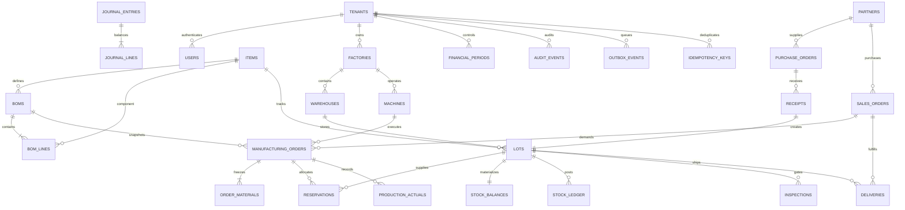

# Implemented data model

Migrations: `V1__manufacturing_core.sql`, `V2__approved_bom_integrity.sql`. Primary IDs are UUID strings except readable demonstration master IDs. Every tenant-owned table carries `tenant_id`; references use owner/id composites where operational records cross domains. Tenant-scoped document/SKU/lot/BOM revision uniqueness prevents duplicates.

`lots.source_type/source_id` identify the purchase/manufacturing/opening document; genealogy follows receipt → lot → reservation/material issue → manufacturing order → finished lot → delivery. Source IDs are polymorphic application-validated references rather than cross-table foreign keys. A full recall explorer, serial tracking and expiry/FEFO are later scope.

`stock_balances` is a materialized projection maintained only by the stock-ledger trigger for quantity/value; reservation updates are transactional application commands. Reconcile `SUM(delta)`/`SUM(value_delta)` per owner/lot against balances, and active reservation totals against `reserved`. `quantity >= reserved >= 0` and nonnegative value constraints reject unauthorized negative stock.

Money/quantity precision is six decimal places (maximum 14 integer digits in the database, stricter API amount limits). UI formatting never changes stored values. SQL indexes cover owner/status/date list and allocation access. Current workspace list snapshots cap at 250 rows (BOM lines 1,000; audit 100), with pagination inside that bound. This is explicitly not the large-ledger reporting solution; replace capped lists with server cursor pagination and background export before scale.

Flyway validates checksums at startup and runs PostgreSQL transactional DDL. Never edit an applied migration. Add a new numbered migration and rehearse it against a restored backup. Posted financial and inventory rows have no delete/overwrite path. Retention/archive cutoffs, erasure handling and access to old records require an organization-approved policy and implementation before commercial data retention commitments.
