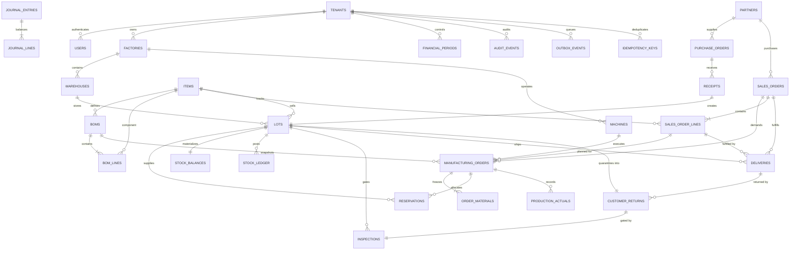
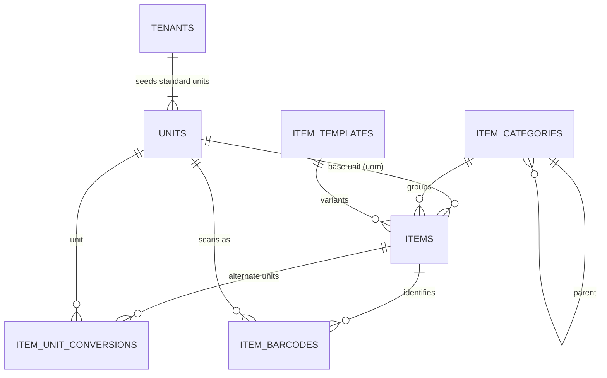
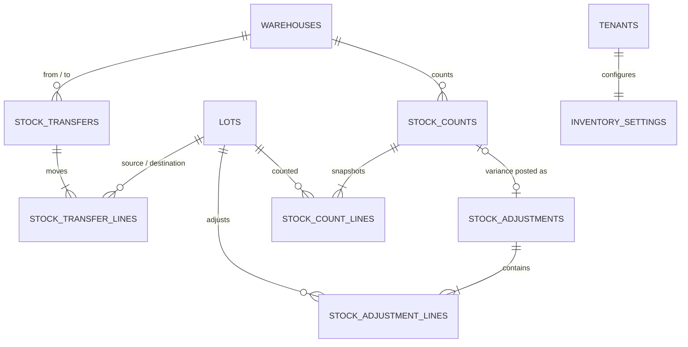
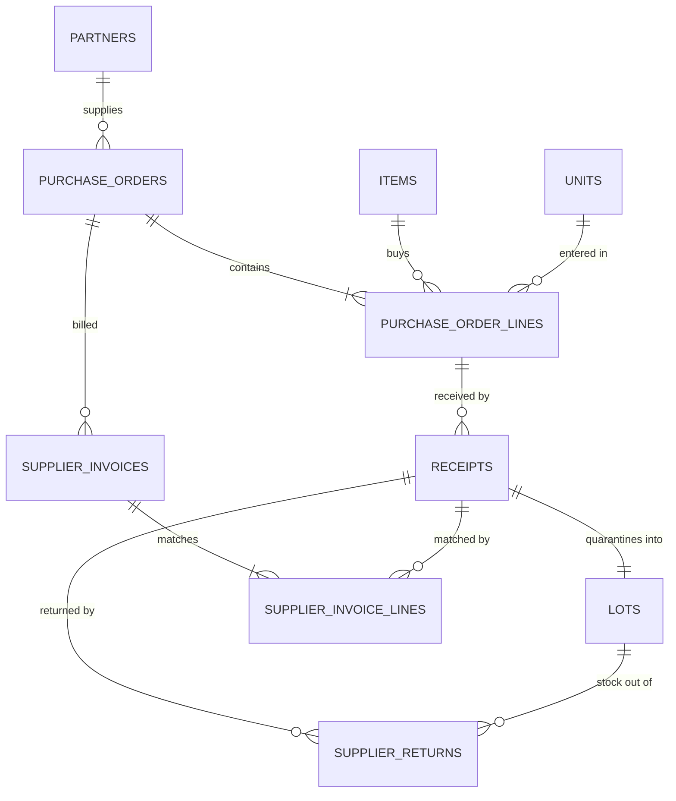
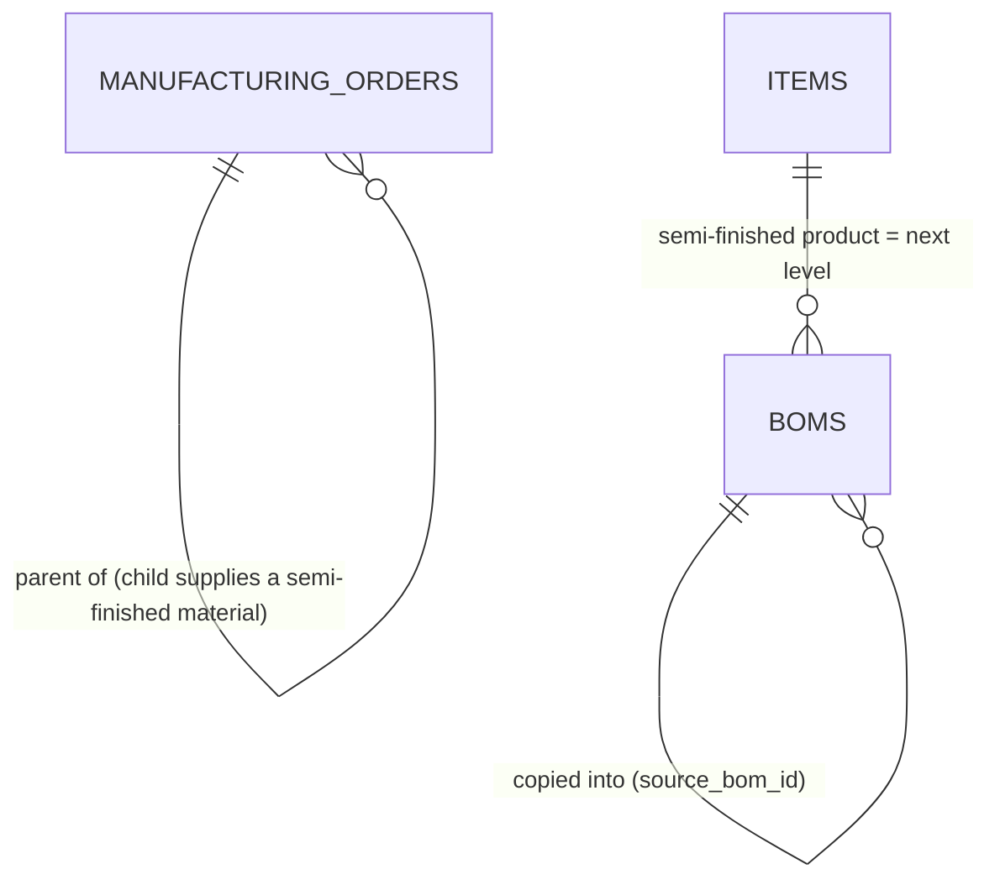
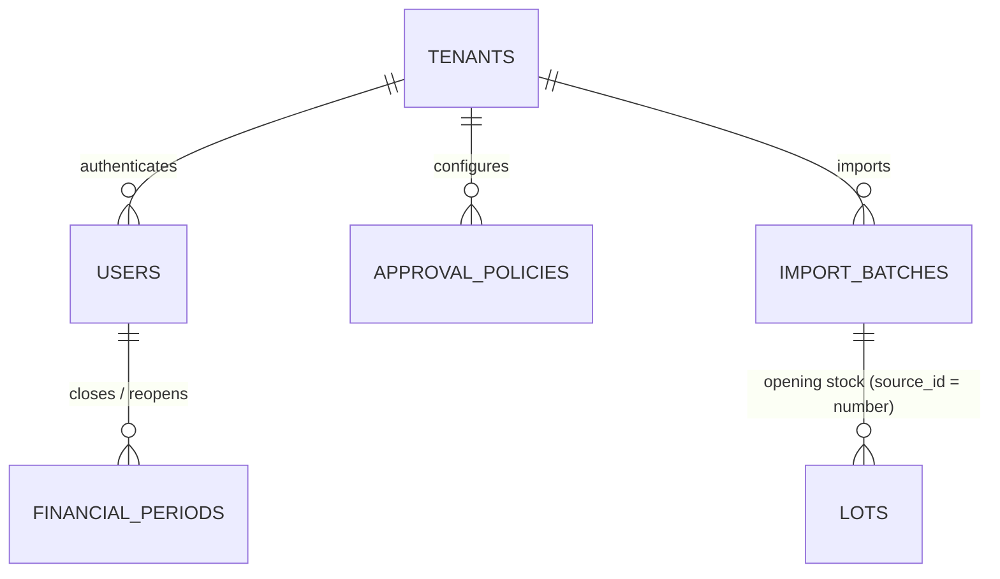
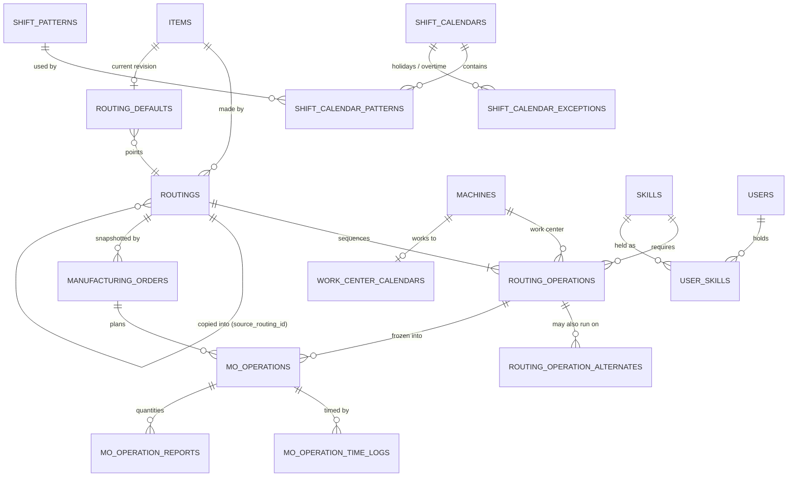
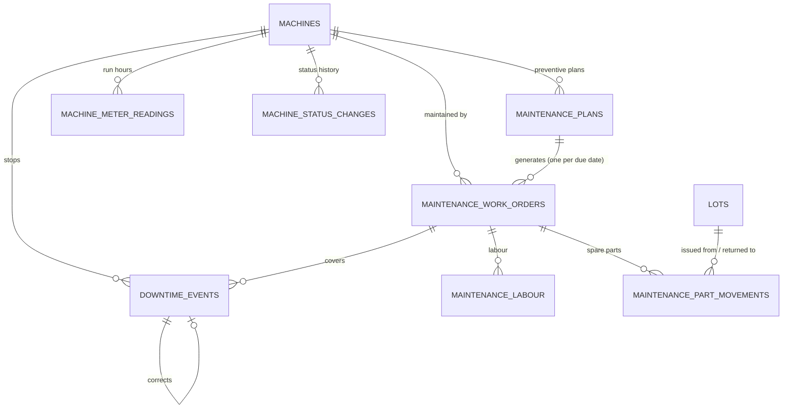
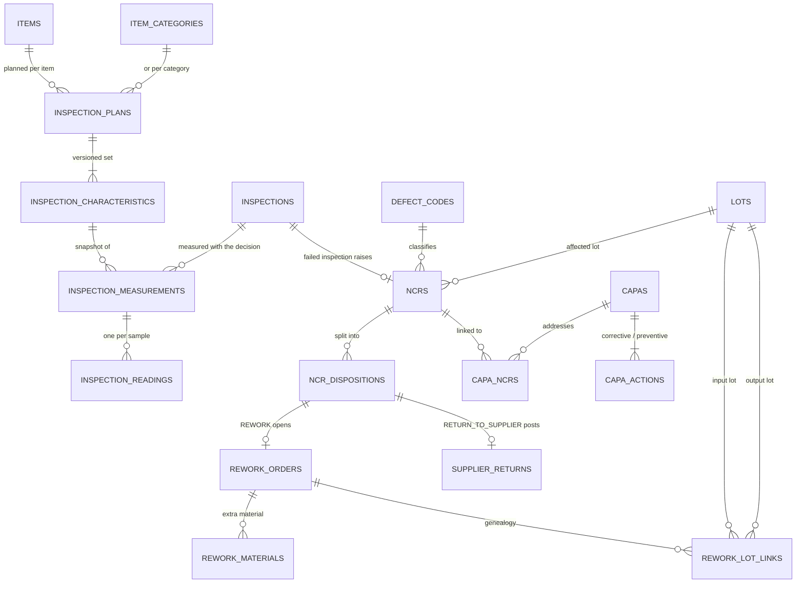
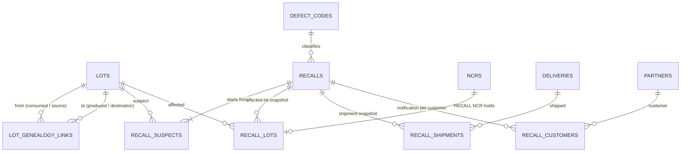

# Implemented data model

Migrations: `V1__manufacturing_core.sql`, `V2__approved_bom_integrity.sql`, `V3__sales_documents_partners_returns.sql`, `V4__item_master.sql` (item master; see below), `V5__inventory_operations.sql` (inventory operations, below), `V6__procurement_documents.sql` (procurement documents, below), `V7__multi_level_bom_planning.sql` (multi-level BOMs and parent/child orders, below), `V8__administration.sql` (administration, below), `V9__integration.sql` (integration, below), `V10__routings_shifts_skills_operations.sql` (routings, shift calendars, skills and operations, below), `V11__maintenance_downtime.sql` (maintenance and downtime, below), `V12__quality_management.sql` (quality management, below), `V14__genealogy_recalls.sql` (genealogy and recalls, below). Primary IDs are UUID strings except readable demonstration master IDs. Every tenant-owned table carries `tenant_id`; references use owner/id composites where operational records cross domains. Tenant-scoped document/SKU/lot/BOM revision uniqueness prevents duplicates.

### Sales documents, partners and customer returns (V3)

- `partners` gains `phone`, `billing_address`, `shipping_address`, `tax_id`, `credit_limit` (customers only, `CHECK`), `active`, `created_at`, `updated_at`. The `partner_must_be_active()` trigger (`BEFORE INSERT` on `purchase_orders`, `BEFORE INSERT OR UPDATE OF customer_id` on `sales_orders`) rejects inactive partners on new documents with SQLSTATE 23514 (HTTP 409).
- `sales_orders` is a document header: `customer_reference`, `notes`, `subtotal`/`discount_total`/`total` (maintained from the lines), `status` ∈ `DRAFT, CONFIRMED, PARTIAL, DELIVERED, CLOSED, CANCELLED` (default `DRAFT`), `status_reason` (cancel/close-short reason), `created_by`, `confirmed_by/at`, `closed_by/at`, `updated_at`. `due_date` is the required-by date. The single-item columns `product_id`, `quantity`, `unit_price`, `delivered` were removed; their values moved to line 1.
- `sales_order_lines`: `line_no` (unique per order), `product_id`, `quantity > 0`, `unit_price ≥ 0`, `discount_pct` 0–100, `line_total` (generated: `round(quantity × unit_price × (100 − discount) / 100, 6)`), `delivered ≤ quantity`, `returned ≤ delivered`. `UNIQUE(tenant_id, sales_order_id, id)` lets children prove a line belongs to their order. V9 adds sales units (`unit`, `factor`, `base_quantity`, `base_unit_price`) and bounds `delivered` by `base_quantity`; see below.
- `deliveries` gains `sales_order_line_id`, `revenue_amount` and `cost_amount` (the posted revenue and COGS of that delivery), `returned ≤ quantity`, `created_by`. `manufacturing_orders` gains `sales_order_line_id`. Both use a composite foreign key `(tenant_id, sales_order_id, sales_order_line_id)` → `sales_order_lines(tenant_id, sales_order_id, id)`, so a line always belongs to the referenced order (nullable: make-to-stock orders have neither).
- `customer_returns` (posted history, `customer_returns_immutable` trigger): `number` (also the quarantine lot number and journal reference), `delivery_id`, `sales_order_id`, `sales_order_line_id`, `lot_id` (the new `QUARANTINE` lot, `source_type = 'CUSTOMER_RETURN'`), `inspection_id` (type `RETURN`), `quantity`, `unit_cost`, `cost_amount`, `credit_amount`, `reason`, `created_by`. The return status shown to users is derived from the inspection: pending → awaiting QC, passed → restocked, failed → rejected (held, value retained).
- Migration of existing data: each single-item order becomes a header plus line 1 (same product, quantity, price, delivered), header totals are computed, existing deliveries and manufacturing orders get the line id, delivery revenue is `round(quantity × price, 6)` and delivery cost is taken from the matching posted `CUSTOMER_DISPATCH` ledger row (lot unit cost as fallback). Posted ledger/journal/audit rows are untouched.
- Indexes: `sales_orders(tenant_id, created_at DESC, id DESC)` (keyset list), `(tenant_id, status, created_at DESC)`, `(tenant_id, customer_id)`; `sales_order_lines(tenant_id, product_id)`; `deliveries(tenant_id, sales_order_id, created_at)`; `customer_returns` by order and delivery; `partners(tenant_id, type, active, name)`; `manufacturing_orders(tenant_id, sales_order_line_id)`; `audit_events(tenant_id, reference, created_at)` for document activity feeds.

## Item master (V4)

| Table / change | Purpose and rules |
|---|---|
| `units` (PK `tenant_id, code`) | Tenant units of measure: `kind` MASS/VOLUME/LENGTH/AREA/COUNT/PACKAGE, `decimals` 0–6 (quantity precision and the rounding scale of conversions), optional `ratio` to the kind's reference unit (kg, l, m, m², pcs) for fixed conversions such as g→kg; PACKAGE units (box, bag, roll…) have no ratio. The trigger `tenant_default_units` (AFTER INSERT ON tenants) seeds 15 standard units for every new tenant; V4 seeded them for existing tenants. Codes are unique case-insensitively. A unit's `decimals` is fixed once items, conversions, barcodes or families use it. |
| `items` (altered) | `uom` now references `units(tenant_id, code)` (the `kg/pcs` CHECK is gone); `type` adds `SEMI_FINISHED`; new `description`, `category_id`, `reorder_qty`, `lead_time_days`, `template_id` + `variant_key` (canonical JSON of the attribute values, unique per family) + `variant_label`, `created_at`, `updated_at`. `reorder_level` remains the safety stock used by MRP. |
| `item_unit_conversions` | 1 `unit_code` = `factor` × the item's base unit (`numeric(24,12)`, > 0), with `purchase`/`sales` usage flags; one per item and unit. Never the base unit, never a unit with a fixed same-kind ratio, and a whole number for count-precision (0-decimal) base units. Conversions never change posted quantities: documents and the ledger store base units. |
| `item_categories` | Optional `parent_id` hierarchy (cycles rejected by the service), names unique per tenant (case-insensitive), `active`. |
| `item_barcodes` | Barcodes unique per tenant (`[!-~]{3,64}`), many per item; optional `unit_code` (one scan = one of that unit, e.g. a shipper GTIN = 1 box = 50 pcs; NULL = one base unit). |
| `item_templates` | Variant families: code (unique per tenant), shared type, base unit, category and `attributes` (`[{"name","values"}]`). Families are not items and are never stocked or used on documents; each variant is an ordinary item linked by `items.template_id`. |
| `item_is_referenced(tenant, item)` | True when any table with a foreign key to `items` (ledger, lots, BOMs, orders, documents — including tables added by later migrations, discovered from `pg_constraint`) references the item; item master tables do not count. |
| `item_identity_guard` (BEFORE UPDATE ON items) | Rejects changing `uom` once stock-ledger rows exist, and `sku`/`uom`/`type` once `item_is_referenced`. The V1 ledger trigger still compares each ledger row's unit with the item's base unit. |

Indexes `im_*` cover the item list filters (type/active, category, family, name), BOM where-used (`bom_lines(tenant_id,item_id)`) and per-item ledger history (`stock_ledger(tenant_id,item_id,created_at)`).

Semi-finished output (an order whose product is `SEMI_FINISHED`) creates an `SF-…` lot in the tenant's RAW warehouse and is valued in `RAW_INVENTORY` (material issue credits `RAW_INVENTORY` when the intermediate is consumed); finished output keeps `FG-…` lots in the FINISHED warehouse and `FG_INVENTORY`.

`lots.source_type/source_id` identify the document that created a lot: `PURCHASE` → purchase order id (the `receipts` row has `lot_id`), `MANUFACTURING` → manufacturing order id, `TRANSFER` → source lot id (V5), `CUSTOMER_RETURN` → customer return id (V3), `REWORK` → rework order id (V12), `ADJUSTMENT` → stock adjustment id (found stock, V5), `OPENING` → import batch number or demo reference. Source IDs are polymorphic application-validated references rather than cross-table foreign keys. Genealogy follows receipt → lot → reservation (ISSUED = consumed by the order) → manufacturing order → output lot (semi-finished lots repeat the step one level up) → transfer lots → delivery → customer-return lot, plus rework (`rework_lot_links`) and terminal outflows read from the stock ledger (supplier returns, quality scrap, maintenance issues, adjustments). V14 walks these links (`lot_genealogy_links` view, below) in the genealogy explorer and recalls. Serial tracking and expiry/FEFO are later scope.

`stock_balances` is a materialized projection maintained only by the stock-ledger trigger for quantity/value; reservation updates are transactional application commands. Reconcile `SUM(delta)`/`SUM(value_delta)` per owner/lot against balances, and active reservation totals against `reserved`. `quantity >= reserved >= 0` and nonnegative value constraints reject unauthorized negative stock.

## Inventory operations (`V5__inventory_operations.sql`)

| Table / change | Purpose and rules |
|---|---|
| `warehouses` + `code`, `active`, `created_at` | `code` unique per tenant (`^[A-Z0-9][A-Z0-9-]{0,19}$`); inserts without a code get `RM`/`FG`/`RM-2`… (trigger `warehouse_default_code`); `kind` checked against `RAW, FINISHED, WIP, QUARANTINE, OTHER` (`NOT VALID`, new and changed rows). Triggers `lot_requires_active_warehouse` / `stock_in_requires_active_warehouse` reject new lots and positive ledger movements in an inactive warehouse (409), whichever domain posts them. |
| `inventory_settings` | One row per tenant: `approval_threshold` (default 50,000), last editor. Backfilled for existing tenants; a missing row means the default. |
| `stock_adjustments`, `stock_adjustment_lines` | Reason `DAMAGE/EXPIRY/FOUND/COUNT_VARIANCE/SAMPLE/OTHER`; status `DRAFT → (APPROVAL_REQUIRED →) POSTED`, or `CANCELLED`; `created_by`, `submitted_by`, `approved_by` for independent approval; `value_increase`/`value_decrease` (estimates until posted, then actual); applied `approval_threshold`. Lines: `INCREASE`/`DECREASE` of an existing lot, or `FOUND` (item, warehouse, unit cost, optional lot number; `lot_id` set to the created lot on posting); `value_delta` is the posted ledger value. |
| `stock_transfers`, `stock_transfer_lines` | `from_warehouse_id <> to_warehouse_id`; status `DRAFT → POSTED` or `CANCELLED`. Lines record `source_lot_id`, the `destination_lot_id` created on posting and the moved `value_amount`. |
| `stock_counts`, `stock_count_lines` | Status `COUNTING → REVIEW → POSTED` or `CANCELLED`; optional `item_id` / `item_type` scope; `blind`. Lines snapshot `snapshot_qty` and `unit_cost` at start; `counted_qty`/`counted_by`; on posting `system_qty` (at posting time), `variance_qty`, `variance_value`, `moved`. Partial unique index `stock_count_lines_one_open_count (tenant_id, lot_id) WHERE open` keeps a lot in at most one open count. `adjustment_id` links the generated `COUNT_VARIANCE` adjustment. |

Posted and cancelled adjustments, transfers and counts — and their lines — are immutable (`protect_closed_inventory_document`, `protect_closed_*_line` triggers, SQLSTATE `23514` → HTTP 409). Stock still changes only through `stock_ledger`: adjustments post `ADJUSTMENT_<reason>` entries; transfers post a value-neutral `TRANSFER_OUT`/`TRANSFER_IN` pair. A transfer creates a destination lot (`source_type='TRANSFER'`, `source_id` = source lot) with the same item, quality status, unit cost and `created_at`, so FIFO allocation keeps the original receipt age. Trigger `transferred_lots_follow_quality` copies a quality decision (QUARANTINE → RELEASED/REJECTED) recorded on a lot to the still-quarantined lots transferred from it, recursively, so the source lot's single pending inspection decides all of them. Receipts awaiting incoming inspection (quarantined `PURCHASE` lots, whose rejection returns the receiving lot's quantity to the supplier) cannot be adjusted, transferred or counted. Inventory GL accounts follow the item type (`FINISHED_GOOD` → `FG_INVENTORY`, others → `RAW_INVENTORY`), not the warehouse; adjustments post against `INVENTORY_ADJUSTMENT` (debit = loss, credit = gain).

Indexes added for the read endpoints: lots by `(tenant_id, created_at DESC, id DESC)`, `(tenant_id, warehouse_id, status)`, `(tenant_id, source_type, source_id)`; ledger by lot, item, warehouse (each with `created_at DESC`) and by reference; documents by `(tenant_id, created_at DESC, id DESC)` and status; lines by document and lot.

## Procurement documents (`V6__procurement_documents.sql`)

| Table / change | Purpose and rules |
|---|---|
| `purchase_orders` (header) | Adds `supplier_reference`, `notes`, `total` (sum of line totals), `status_reason` (cancel/close-short), `submitted_by/at`, `approved_by/at`, `closed_by/at`, `updated_at`. `due_date` is the expected delivery date. `status` ∈ `DRAFT, SUBMITTED, APPROVED, PARTIAL, RECEIVED, CLOSED, CANCELLED` (default `DRAFT`). `supplier_id` is nullable only while `DRAFT`/`CANCELLED` (`purchase_orders_supplier_required`; planning drafts without a known supplier). The single-item columns `item_id`, `quantity`, `unit_cost`, `received` were removed; their values moved to line 1. Triggers `purchase_partner_active` (insert with a supplier) and `purchase_partner_changed` (supplier changed) reuse V3's `partner_must_be_active()`. |
| `purchase_order_lines` | `line_no`, `item_id`, `quantity` + `unit` (entered purchase unit, FK `units`), `factor` (base units per unit, `numeric(24,12)`), `base_quantity` (exact conversion), `unit_cost` (per entered unit), `base_unit_cost` (`unit_cost / factor`, 6 dp; the lot cost of receipts), `line_total` (generated `round(quantity × unit_cost, 6)`), `received ≤ base_quantity` and `returned ≤ received` (base units), optional `expected_date`. `UNIQUE(tenant_id, purchase_order_id, id)` lets children prove a line belongs to their order. |
| `receipts` (altered) | One row per received line and lot: adds `purchase_order_line_id` (composite FK to the order's line), `number` (the goods-receipt `GRN-…` number shared by lines received together), `delivery_note`, `entered_quantity`/`entered_unit`, `unit_cost` and `value_amount` (the posted `GOODS_RECEIPT` value), `invoiced`, `returned`, `credited` (returned after invoicing, settled against payables) and `created_by`; `CHECK(credited ≤ invoiced, credited ≤ returned, returned ≤ quantity, invoiced + returned − credited ≤ quantity)`. `invoice_reference` keeps the last matched supplier reference. |
| `supplier_invoices`, `supplier_invoice_lines` (posted history, immutable triggers) | Header: internal `number` (`SINV-…`), `purchase_order_id`, `supplier_id`, `supplier_reference`, `invoice_date`, `amount` (billed = accounts payable), `matched_amount` (GRNI released at receipt cost), `price_variance = amount − matched_amount`, `status` `MATCHED`/`VARIANCE`. Lines: one per receipt with `quantity`/`unit_price` (base unit), `amount`, `po_unit_cost`, `matched_amount`, `price_variance`, `open_quantity` (what the receipt still had to invoice) and `quantity_variance = quantity − open_quantity ≤ 0`; FKs prove receipt → line → order consistency. |
| `supplier_returns` (posted history, immutable trigger) | `number` (`SR-…`, also the ledger/journal reference), receipt, lot, line, supplier, item, `quantity`, `value_amount` (ledger value at the lot's balance average), `clearing_quantity/amount` (part not yet invoiced → Dr GRNI) + `payable_quantity/amount` (part invoiced → Dr ACCOUNTS_PAYABLE) summing to the totals, `debit_note`, `reason`, `created_by`. |

Migration of existing data: every single-item order becomes a header plus line 1 in the item's base unit (factor 1, same quantity, cost and received); legacy `DRAFT` (which meant "awaiting approval") becomes `SUBMITTED` with `submitted_by = created_by`; header `total = round(quantity × unit_cost, 6)`. Receipts get their line, a `GRN-…` number, `entered_*` = base quantity/unit, `unit_cost` from the lot and `value_amount` from the lot's `GOODS_RECEIPT` ledger row; receipts with an `invoice_reference` become one `MATCHED` supplier invoice each (dated by the matching journal entry) and `invoiced = quantity`. Posted ledger/journal/audit rows are untouched. Indexes: orders by `(tenant_id, created_at DESC, id DESC)`, status and supplier; lines by item (MRP supply); receipts by created/order/lot; invoices and returns by created/order/receipt and invoices by supplier reference.

Money/quantity precision is six decimal places (maximum 14 integer digits in the database, stricter API amount limits). UI formatting never changes stored values. SQL indexes cover owner/status/date list and allocation access. Current workspace list snapshots cap at 250 rows (BOM lines 1,000; audit 100), with pagination inside that bound. This is explicitly not the large-ledger reporting solution; replace capped lists with server cursor pagination and background export before scale.

Flyway validates checksums at startup and runs PostgreSQL transactional DDL. Never edit an applied migration. Add a new numbered migration and rehearse it against a restored backup. Posted financial and inventory rows have no delete/overwrite path. Retention/archive cutoffs, erasure handling and access to old records require an organization-approved policy and implementation before commercial data retention commitments.

## Multi-level BOMs and parent/child orders (`V7__multi_level_bom_planning.sql`)

| Table / change | Purpose and rules |
|---|---|
| Multi-level structure (no new table) | A `bom_lines` component of type `SEMI_FINISHED` whose product has an approved revision is the next level. The **active** revision of a product is its most recently created approved revision (`mlb_boms_product_status` index). Approval (service rule, inside the tenant lock) requires an approved revision for every semi-finished component and rejects any path of approved revisions back to the product, so the approved structure is acyclic and complete. Approved revisions and their lines stay immutable (V2). |
| `boms.source_bom_id` | Nullable composite FK `(tenant_id, source_bom_id)` → `boms`: the approved revision a draft was copied from. Adding the column fires no row trigger, so approved revisions were not touched. Drafts can be edited (output, yield, lines) until approved. |
| `manufacturing_orders.parent_order_id` | Nullable composite FK `(tenant_id, parent_order_id)` → `manufacturing_orders` (same tenant), `CHECK (parent_order_id <> id)`, partial index `mlb_mo_parent`. Set when a child order is created (parent DRAFT/APPROVED, consuming the child's product, due no earlier than the child); the trigger `mo_parent_immutable` (`BEFORE UPDATE OF parent_order_id`) rejects any change with SQLSTATE 23514 → HTTP 409, so a child always points at an older order and links cannot form a cycle. Children are ordinary orders: their own snapshot, approval, reservation and output. |
| `mlb_order_materials_item` | `order_materials(tenant_id, item_id)` for MRP demand by material. |

Planning is a read model: MRP (low-level codes, netting, pegging, planned production and purchase recommendations) is computed per request from open orders, approved revisions, stock, open orders and purchase supply; nothing is stored.

Money/quantity precision is six decimal places (maximum 14 integer digits in the database, stricter API amount limits). UI formatting never changes stored values. SQL indexes cover owner/status/date list and allocation access. Current workspace list snapshots cap at 250 rows (BOM lines 1,000; audit 100), with pagination inside that bound. This is explicitly not the large-ledger reporting solution; replace capped lists with server cursor pagination and background export before scale.

Flyway validates checksums at startup and runs PostgreSQL transactional DDL. Never edit an applied migration. Add a new numbered migration and rehearse it against a restored backup. Posted financial and inventory rows have no delete/overwrite path. Retention/archive cutoffs, erasure handling and access to old records require an organization-approved policy and implementation before commercial data retention commitments.

## Administration (`V8__administration.sql`)

| Table / change | Purpose and rules |
|---|---|
| `users` + `created_at`, `updated_at`, `last_login_at`, `password_changed_at`, `deactivated_at`, `must_change_password`, `session_version` | `session_version` is copied into the session principal at sign-in and incremented on deactivation, administrator password reset and self-service change; `platform.SessionGuard` ends sessions with an older version on their next request (works across restarts and API processes). `must_change_password` is set by a reset and for accounts created through `POST /users`. Index `users_tenant_name (tenant_id, lower(name), id)` for the paged directory. Trigger `users_keep_an_active_admin` (`BEFORE UPDATE OF role, active`) rejects demoting or deactivating a tenant's last active ADMIN. |
| `approval_policies` | PK `(tenant_id, document_type)`, `document_type` ∈ `MANUFACTURING_ORDER`, `PURCHASE_ORDER`, `STOCK_ADJUSTMENT`; `approval_required`, `amount_threshold` (NULL = every document), `approver_roles` (comma list ⊆ `PLANNER, WAREHOUSE, QUALITY, SALES, OPERATOR`; ADMIN always approves), `updated_by/at`. A missing row means the built-in default (orders: always, PLANNER; adjustments: above 50,000, PLANNER/WAREHOUSE). Migration: every V5 `inventory_settings` row became a `STOCK_ADJUSTMENT` policy with the same threshold and editor; `inventory_settings` was dropped. |
| `import_batches` | One row per committed CSV file: `number` (`IMP-…`), `kind` (`ITEMS`, `PARTNERS`, `OPENING_STOCK`), `file_name`, `content_hash` (SHA-256 of the normalized text), `row_count`, `total_value` (opening stock), `summary` (JSON text), `created_by`. `UNIQUE (tenant_id, kind, content_hash)` makes an import idempotent per file content; immutable (`import_batches_immutable`). Opening-stock lots carry `source_type='OPENING'`, `source_id` = batch number; their ledger rows use reason `OPENING_STOCK_IMPORT` and reference the batch number, as do the `RAW_INVENTORY`/`FG_INVENTORY` ↔ `OPENING_EQUITY` journal entries. |
| `financial_periods` + `closed_by`, `closed_at`, `reopened_by`, `reopened_at`, `reopen_reason`, `created_at` | A period ends on `end_date` and starts the day after the previous row's `end_date`. Closing is in date order and never in the future; only the latest closed period can be reopened (reason kept; audited). `Store.openPeriod` is unchanged. |
| `audit_events` indexes | `audit_tenant_created` replaced by `audit_tenant_created_id (tenant_id, created_at DESC, id DESC)` for keyset paging; plus `(tenant_id, action, created_at DESC)` and `(tenant_id, actor, created_at DESC)` for the filters. |

## Integration (`V9__integration.sql`)

| Table / change | Purpose and rules |
|---|---|
| `sales_order_lines` + `unit`, `factor numeric(24,12)`, `base_quantity`, `base_unit_price` | Mirrors V6 purchase-order lines: `quantity` and `unit_price` are in the entered sales unit (the product's base unit, an item conversion flagged for sales or a same-kind standard unit; composite FK `(tenant_id, unit)` → `units`); `base_quantity = quantity × factor` exactly at the base unit's precision (`UnitService.toBaseExact`), `base_unit_price = unit_price / factor` (6 dp). `line_total` stays `quantity × unit_price` less the discount. `delivered` (and so `returned`) is a base quantity: the inline V3 bound `delivered ≤ quantity` was replaced by `sales_order_lines_delivered_check (delivered ≤ base_quantity)`; `CHECK`s keep `factor > 0`, `base_quantity > 0`, `base_unit_price ≥ 0`. Migration: every existing line gets its product's base unit, factor 1, `base_quantity = quantity`, `base_unit_price = unit_price`. |
| `stock_counts.category_id` | Optional composite FK `(tenant_id, category_id)` → `item_categories`: the count covered that category and all of its sub-categories (resolved when the count starts; later category moves do not change the snapshot). |
| Keyset indexes | `mo_tenant_created_id`, `inspections_tenant_created_id`, `journal_entries_tenant_created_id` on `(tenant_id, created_at DESC, id DESC)`; `journal_lines(tenant_id, entry_id)` and `(tenant_id, account)` for `GET /manufacturing/orders`, `/quality/inspections`, `/reports/costs` and `/reports/journal`. |
| Approval policies (no schema change) | The V8 `approval_policies` rows now also govern manufacturing orders (evaluated on creation with `estimated_cost`) and purchase orders (on submission with `total`). An order the policy auto-approves is stored `APPROVED`; a purchase order then has `approved_at` set and `approved_by` empty, and the audit trail records `MO_AUTO_APPROVED` / `PO_AUTO_APPROVED`. |

## Routings, shift calendars, skills and operations (`V10__routings_shifts_skills_operations.sql`)

| Table / change | Purpose and rules |
|---|---|
| `users_tenant_id_unique` (index) | `UNIQUE (tenant_id, id)` on `users` (`IF NOT EXISTS`), so V10 rows reference a user of the same tenant through a composite key. |
| `skills` | Catalogue: `code` (`^[A-Z0-9][A-Z0-9-]{0,19}$`, unique per tenant), `name`, `description`, `active`, `created_by`. Inactive skills cannot be required by new routings or recorded for users. |
| `user_skills` | PK `(tenant_id, user_id, skill_id)`: `level` 1 (trainee) … 5 (expert), `certified_until` (last valid day, Asia/Colombo; NULL = no expiry), `notes`, `updated_by/at`. A user qualifies for an operation when level ≥ the required level and the certification has not expired (`routing.SkillRules`). |
| `routings` | Revision of how a FINISHED_GOOD or SEMI_FINISHED product is made: `number` (`RT-…`, the audit reference), `revision` (unique per product, case-insensitive), `status` `DRAFT`/`APPROVED`, `notes`, `source_routing_id` (copied from), `created_by`, `updated_by` (last editor), `approved_by/at` (`CHECK`: set exactly when approved). Approval needs a person other than `created_by` and `updated_by`. Keyset index `(tenant_id, created_at DESC, id DESC)`. |
| `routing_operations` | `seq` 1–9999 (unique per routing), `name`, `machine_id` (work center), `setup_minutes` (once per order), `run_minutes_per_unit` `numeric(24,12)` (minutes per base unit of the product: 1,200 pcs/h = 0.05), `crew_size` `numeric(6,2)` > 0 (labour minutes = machine minutes × crew), optional `skill_id` + `skill_level` 1–5, `inspection_point`, `instructions`. |
| `routing_operation_alternates` | Other work centers an operation may run on (same machine kind as the primary, checked by the service). |
| `routing_defaults` | PK `(tenant_id, product_id)` → `routing_id` (composite FK proves the routing belongs to the product): the **current** revision, at most one per product. Approval sets it to the new revision; `make-current` switches to an older approved revision. New manufacturing orders snapshot this revision. |
| `shift_patterns` | One shift: `code`, `start_time`, `end_time` (≤ start = ends the next day; a shift belongs to its start date), one unpaid break (`break_minutes`, `break_start`, NULL = centred), `weekdays` bit mask (bit 0 = Monday … bit 6 = Sunday). |
| `shift_calendars`, `shift_calendar_patterns` | A calendar is a set of patterns; `plant_default` (partial unique index: one per tenant) applies to every work center without its own calendar. |
| `shift_calendar_exceptions` | `exception_date`, `kind` `CLOSED` (holiday: no shift starts that day; one per date, partial unique index) or `OVERTIME` (`start_time`–`end_time`, required, different; ends the next day when not after the start), `reason`, `created_by`. Overtime counts even on a closed date; overlaps with shifts count once. |
| `work_center_calendars` | PK `(tenant_id, machine_id)` → `calendar_id`; no row = plant default; no plant default = available around the clock. |
| `manufacturing_orders` + `routing_id`, `routing_revision` | The routing revision an order snapshotted at creation (NULL = no routing: the single implicit operation of earlier releases). Composite FK to `routings`; partial index `mo_routing`. |
| `mo_operations` | One row per routing operation, frozen at order creation: `routing_operation_id`, `seq`, `name`, `planned_machine_id` and `machine_id` (the work center that runs it: planned, or an alternate chosen at start), `planned_quantity` (the order quantity), `setup_minutes`, `run_minutes_per_unit`, `planned_run_minutes` (= quantity × run minutes per unit, 6 dp), generated `planned_minutes` (setup + run), `crew_size`, skill, `inspection_point`, `instructions`; execution: `status` `PENDING → READY → IN_PROGRESS ⇄ PAUSED → DONE` or `CANCELLED`, `activity` (`SETUP`/`RUN` exactly while IN_PROGRESS), cumulative `good_qty`/`scrap_qty`, `operator_id`, `ready_at`, `started_at` (first start), `finished_at` (exactly when DONE). Trigger `mo_operation_snapshot`: the planned columns never change, DONE/CANCELLED rows are immutable, no row is deleted. Indexes `(tenant_id, machine_id, status)` (shop-floor queue, scheduling) and `(tenant_id, status)`. |
| `mo_operation_time_logs` | Actual machine time for OEE: one row per uninterrupted `SETUP` or `RUN` interval of an operation on a work center (`machine_id`), with `user_id`, `crew_size`, `started_at`, `ended_at` (NULL while running), `end_reason` (`PAUSED`, `FINISHED`, `SWITCHED` = setup done, `ORDER_PAUSED`), generated `minutes` (machine) and `labour_minutes` (× crew), `skill_override_reason`. Partial unique indexes: one open interval per operation **and per work center** (one running operation per machine). Trigger `mo_time_log_closed_immutable`: closed rows cannot change, rows cannot be deleted. Indexes by tenant, work center, operation and order with `started_at`. |
| `mo_operation_reports` | Good/scrap reports per operation (`machine_id`, `notes`, `reported_by`, `created_at`; `good + scrap > 0`); posted history (`reject_history_mutation()`). Execution records only: stock and cost move through the order's output command. |

Triggers: `approved_routing_immutable` (BEFORE UPDATE/DELETE on `routings`: an APPROVED row cannot change), `approved_routing_operation_immutable` and `approved_routing_alternate_immutable` (no insert/update/delete of the operations or alternates of an approved routing), `routing_default_approved` (only an approved routing can be current), `mo_operation_snapshot`, `mo_time_log_closed_immutable`, `mo_operation_reports_immutable`. All raise plain exceptions (HTTP 409 with the message).

Working time is not stored: `routing.CalendarService` computes it from patterns, exceptions and assignments on every call (calendar changes apply to past and future dates; a consumer that needs frozen planned time stores its own snapshot). Operations never post stock ledger or journal rows.

## Maintenance and downtime (`V11__maintenance_downtime.sql`)

| Table / change | Purpose and rules |
|---|---|
| `users.role` | `users_role_check` adds `MAINTENANCE` (executes work orders, issues spare parts). Approver roles of `approval_policies` are unchanged. |
| `items.type`, `item_templates.type` | `items_type_check` / `item_templates_type_check` add `SPARE_PART`: ordinary stock items (lots, ledger, receipts with incoming inspection, counts; valued in `RAW_INVENTORY`). The catalog refuses them as BOM components, so MRP only replenishes them to their reorder level (action `PURCHASE`). |
| `downtime_events` | One stop of a machine: `number` (`DT-…`), `machine_id`, `reason` ∈ `BREAKDOWN`, `PLANNED_MAINTENANCE`, `CHANGEOVER`, `MATERIAL_SHORTAGE`, `NO_OPERATOR`, `QUALITY_HOLD`, `UTILITIES`, `OTHER`; `planned` (`BREAKDOWN` never, `PLANNED_MAINTENANCE` always: `CHECK`s); `started_at`, `ended_at timestamptz` (NULL while `OPEN`; `ended_at > started_at`); `status` ∈ `OPEN`, `CLOSED`, `SUPERSEDED`, `VOID`; optional `manufacturing_order_id`, `work_order_id`; `notes`, `reported_by`, `closed_by/at`; `corrects_id` + `correction_reason` (a correcting entry; unique per corrected event). Trigger `downtime_event_guard`: no deletes; SUPERSEDED/VOID rows are frozen; a CLOSED row may only become SUPERSEDED (all other columns unchanged); an OPEN row keeps its machine and start. Trigger `downtime_no_overlap`: effective events (OPEN/CLOSED) of one machine never overlap (`[start, end)`, open = infinity). Indexes by `(tenant, started_at, id)`, machine, reason, open events and work order. |
| `machine_downtime` (view) | The effective downtime record: `downtime_events` with status `OPEN` or `CLOSED` (`id, tenant_id, number, machine_id, reason, planned, started_at, ended_at, status, manufacturing_order_id, work_order_id, notes, reported_by, created_at, closed_by, closed_at, corrects_id`). **Finite-capacity scheduling (V13) and OEE (V15) read this view**, never the raw table. |
| `maintenance_work_orders` | `number` (`MWO-…`), `type` `CORRECTIVE`/`PREVENTIVE` (preventive ⇔ `plan_id` and `due_date` set), `machine_id`, `title`, `description`, `priority` (`NORMAL`/`HIGH`/`URGENT`), `status` `REQUESTED` → `APPROVED` → `SCHEDULED` → `IN_PROGRESS` → `COMPLETED`, or `CANCELLED`; `scheduled_start/scheduled_end timestamptz` (both or neither, end after start; required for SCHEDULED), `assignee_id`, `checklist jsonb` (`[{task, result: PASS/FAIL/NA/null, note}]`, a snapshot of the plan), `findings`, `actions`, `labour_hours`, `labour_cost`, `parts_cost` (net of returns), `meter_reading`, requester/approver/starter/completer/canceller with timestamps, `cancel_reason`. Unique `(tenant, plan_id, due_date)` (generation is idempotent per occurrence) and one `IN_PROGRESS` order per machine (partial unique index). Trigger `maintenance_work_order_immutable` freezes COMPLETED and CANCELLED orders. **V13 blocks capacity with `scheduled_start/scheduled_end` of APPROVED/SCHEDULED/IN_PROGRESS orders** (index `maintenance_work_orders_tenant_window`). |
| `maintenance_plans` | `number` (`PM-…`), `machine_id`, `title`, `description`, `checklist jsonb` (`["task", …]`), `interval_days` (1–3,650, always set) and optional `interval_hours` (run hours: whichever comes first), `estimated_hours` (window length of generated orders), `priority`, `next_due_date`, `meter_at_last_service`, `last_completed_at`, `active`. Completion sets `next_due_date` = completion day (Asia/Colombo) + interval and the meter baseline to the latest reading; cancelling a generated order moves the due date on by one interval; a meter reading reaching `interval_hours` pulls `next_due_date` to today. |
| `maintenance_labour` | Immutable labour entries: `technician_id`, `hours` (± ≤ 1,000; negatives reverse), `rate` (snapshot of the tenant rate), `cost`, `notes`. Each posts Dr `MAINTENANCE_EXPENSE` / Cr `MAINTENANCE_LABOUR_CLEARING` (reversed for negative hours). |
| `maintenance_part_movements` | Immutable `ISSUE` / `RETURN` (`returns_id` → the issue) rows: `lot_id`, `item_id`, `quantity`, `value_amount`. Issues consume released unreserved lots oldest first through `stock_ledger` reason `MAINTENANCE_ISSUE` and post Dr `MAINTENANCE_EXPENSE` / Cr the item's inventory account; returns put the quantity back into the same lot at the issue's unit value (reason `MAINTENANCE_RETURN`) with the reversed journal. Both are refused in a closed period. |
| `machine_meter_readings` | Immutable run-hour readings per machine (never decreasing). |
| `machine_status_changes` | Immutable history of the status changes maintenance makes: `from_status`, `to_status`, `source` (`MAINTENANCE_ORDER`: start → MAINTENANCE, completion → IDLE; `MANUAL`: a planner's correction to IDLE/RUNNING with a reason), `reference`, `changed_by/at`. Production-driven RUNNING/IDLE changes are not recorded here. |
| `maintenance_settings` | Per tenant `labour_rate` (LKR per hour; default 1,500 when no row exists), `updated_by/at`. |

Downtime does not change `machines.status`; only maintenance work orders (start/complete) and planner corrections do. `ManufacturingService` still refuses issue/start of an MO on a MAINTENANCE machine; starting maintenance is refused while an MO is `IN_PROGRESS`/`PARTIALLY_COMPLETED` on the machine.

Money/quantity precision is six decimal places (maximum 14 integer digits in the database, stricter API amount limits). UI formatting never changes stored values. SQL indexes cover owner/status/date list and allocation access. Current workspace list snapshots cap at 250 rows (BOM lines 1,000), with pagination inside that bound. This is explicitly not the large-ledger reporting solution; replace capped lists with server cursor pagination and background export before scale.

Flyway validates checksums at startup and runs PostgreSQL transactional DDL. Never edit an applied migration. Add a new numbered migration and rehearse it against a restored backup. Posted financial and inventory rows have no delete/overwrite path. Retention/archive cutoffs, erasure handling and access to old records require an organization-approved policy and implementation before commercial data retention commitments.

## Quality management (`V12__quality_management.sql`)

| Table / change | Purpose and rules |
|---|---|
| `defect_codes` | PK `(tenant_id, code)`, `code` `^[A-Z0-9][A-Z0-9_-]{0,19}$`, `name`, `description`, `active`, `system`. Seeded for every existing and new tenant by `seed_default_defect_codes` (trigger `tenant_default_defect_codes` `AFTER INSERT ON tenants`): `INSP` (system: failed inspection, unclassified), `DIM`, `VIS`, `LEAK`, `CONT`, `MAT`, `PACK`, `DOC`, `OTHER`. |
| `inspection_plans` | `number` (`QP-…`), `name`, exactly one of `item_id` / `category_id` (composite FKs), `inspection_type` ∈ `INCOMING, FINAL, RETURN, REWORK`, `active`, `version` (+1 per edit), `notes`, `created_by`, `updated_by`. Partial unique indexes: one active plan per (item, type) and per (category, type). |
| `inspection_characteristics` | `plan_id`, `seq`, `name`, `kind` ∈ `VARIABLE` (unit, optional nominal, at least one of `lower_limit`/`upper_limit` with lower ≤ upper, `sample_size` 1–20 readings) / `ATTRIBUTE` (pass/fail of `sample_size` units, no limits), `critical`, optional `defect_code` (FK), `method`, `active`. Editing a plan retires the current rows (`active = false`) and inserts the new set, so measurements keep their characteristic. |
| `applicable_inspection_plan(tenant, item, type)` | SQL function, used by the decision and the read model: the active plan of exactly that type (RETURN and REWORK fall back to FINAL), the item's own plan before a category plan, the nearest category (walking `item_categories.parent_id`) first. |
| `inspection_measurements` + `inspection_readings` | Posted history (`inspection_measurements_immutable`, `inspection_readings_immutable`), written in the same transaction as the decision: one row per characteristic with a snapshot of its specification (`plan_version`, `name`, `kind`, `unit`, `nominal`, limits, `sample_size`, `critical`), `min/max/mean_value` or `nonconforming`, `conforming`, `note`, `recorded_by`; one reading row per sample. `UNIQUE (tenant_id, inspection_id, characteristic_id)`. |
| `ncrs` | `number` (`NCR-…`), `status` ∈ `OPEN, DISPOSITIONED, CLOSED, CANCELLED`, `source` ∈ `INSPECTION, PRODUCTION, SUPPLIER, CUSTOMER, INTERNAL, AUDIT, RECALL`, `severity` ∈ `MINOR, MAJOR, CRITICAL`, `defect_code`, `title`, `description`, `containment`; links (all optional, composite FKs) `item_id`, `lot_id`, `inspection_id`, `manufacturing_order_id`, `supplier_id`, `customer_return_id`, `rework_order_id` (the rework order that produced the lot); `quantity ≥ 0` (affected), `uom`, `hold_applied` (raising it quarantined a released lot), close/cancel fields. `ncrs_failed_inspection`: one NCR per failed inspection; `ncrs_open_lot`: at most one OPEN NCR per lot. |
| `ncr_dispositions` | `line_no`, `type` ∈ `USE_AS_IS, SCRAP, RETURN_TO_SUPPLIER, REWORK`, `status` ∈ `PENDING_APPROVAL` (concessions only), `AWAITING_RETURN` (returns only), `POSTED`, `REJECTED`; `lot_id`, `quantity > 0`, `value_amount` (value that left the lot), `note`, `reference` (ledger/journal reference: NCR number for scrap, `RW-…`, `SR-…`), `receipt_id`, `rework_order_id`, `supplier_return_id`, `automatic` (the Phase 1 return of a failed incoming lot), `created_by`, `decided_by/at`, `decision_note`, `posted_at`. Non-rejected dispositions never exceed the NCR quantity (service rule under the NCR row lock); the NCR becomes DISPOSITIONED when POSTED dispositions equal it. |
| `rework_orders` | `number` (`RW-…`), `ncr_id`, `disposition_id`, `status` ∈ `OPEN, COMPLETED`, `item_id`, `input_lot_id`, `input_quantity`, `input_value`, `material_cost`, `labour_cost`, `output_lot_id`, `output_quantity`, `output_value`, instructions, completion note. `CHECK`: an open order has no output; a completed one has `output_value = input_value + material_cost + labour_cost` (value conservation enforced by the database). |
| `rework_materials` | Extra material issued from released lots into a rework order (`lot_id`, `item_id`, `quantity`, `value_amount`); immutable. |
| `rework_lot_links` | **Genealogy of rework** (immutable, `rework_lot_links_immutable`): one row per lot consumed by a completed rework order → the lot it produced: `rework_order_id`, `input_lot_id`, `output_lot_id`, `role` ∈ `REWORKED` (the held nonconforming lot) / `MATERIAL` (extra material), `quantity` consumed, `value_amount`. Indexed by input and by output lot, so a trace can walk forwards and backwards. The output lot itself carries `source_type = 'REWORK'`, `source_id` = the rework order. |
| `capas` | `number` (`CAPA-…`), `title`, `problem`, `source` ∈ `NCR, AUDIT, CUSTOMER, SUPPLIER, INTERNAL`, `status` ∈ `OPEN, IN_PROGRESS, VERIFICATION, CLOSED, CANCELLED`, `owner_id`, `due_date`, `root_cause_category` ∈ `MAN, MACHINE, METHOD, MATERIAL, MEASUREMENT, ENVIRONMENT`, `why_1`…`why_5`, `root_cause`, `effective`, `verification_note`, `verified_by/at`. `CHECK`: a CLOSED CAPA was verified effective by someone other than its owner. |
| `capa_ncrs`, `capa_actions` | Links CAPA ↔ NCR (many to many). Actions: `seq`, `type` ∈ `CORRECTIVE, PREVENTIVE`, `description`, `owner_id`, `due_date`, `status` ∈ `OPEN, DONE, CANCELLED`, completion fields; overdue = OPEN and `due_date < CURRENT_DATE` (index `(tenant_id, status, due_date)`). |
| Lot status (no schema change) | A lot is held while QUARANTINE or REJECTED. Raising an NCR on a RELEASED lot sets QUARANTINE (manufacturing issue already refuses reserved lots that are not released). When the lot's open NCR is dispositioned or cancelled, a QUARANTINE lot without a pending inspection is released; a REJECTED lot is released only when its remaining balance is covered by approved concessions. The V5 trigger `transferred_lots_follow_quality` carries a release to lots transferred while quarantined. |

Postings (all through `Store.ledger` / `Store.journal`, period-checked, in the command's transaction):

| Movement | Ledger reason (reference) | Journal |
|---|---|---|
| Scrap disposition | `QUALITY_SCRAP` (NCR number) | Dr `QUALITY_LOSS` / Cr `FG_INVENTORY` or `RAW_INVENTORY` (by item type) |
| Rework input | `REWORK_ISSUE` (RW number) | Dr `REWORK_WIP` / Cr the input lot's inventory account |
| Rework material | `REWORK_MATERIAL` (RW number) | Dr `REWORK_WIP` / Cr the material's inventory account |
| Rework labour | — | Dr `REWORK_WIP` / Cr `CONVERSION_CLEARING` |
| Rework output | `REWORK_OUTPUT` (RW number), explicit value = input + material + labour | Dr inventory account / Cr `REWORK_WIP` (`REWORK_WIP` nets to zero per order) |
| Return to supplier | `SUPPLIER_RETURN` (`SR-…`), via `procurement.SupplierReturnService` | Dr `GRNI` (uninvoiced part) and Dr `ACCOUNTS_PAYABLE` (invoiced part, debit note) / Cr `RAW_INVENTORY` |
| Failed incoming inspection (unchanged) | `SUPPLIER_RETURN_QC` (purchase order id) | Dr `GRNI` / Cr `RAW_INVENTORY`; recorded on the NCR as an automatic RETURN_TO_SUPPLIER disposition |

For genealogy/recall (V14): follow `rework_lot_links` (input lot → output lot) and `lots.source_type='REWORK'`; NCRs reference the lot, inspection, MO, supplier and customer return, and `ncrs.source` already accepts `RECALL` (raising an NCR on a released lot holds it). For OEE (V15): quality losses are `ncr_dispositions` of type SCRAP (quantity, `value_amount`, `posted_at`) and the `QUALITY_SCRAP` ledger rows; rework yield is `rework_orders.output_quantity / input_quantity`; a manufacturing order whose failed final lot is fully dispositioned now completes (V12 generalization of the Phase 1 completion rule).

## Genealogy and recalls (`V14__genealogy_recalls.sql`)

| Table / change | Purpose and rules |
|---|---|
| Genealogy indexes | `reservations(tenant_id, lot_id) WHERE status='ISSUED'`, `deliveries(tenant_id, lot_id)` and `(tenant_id, reference)`, `stock_transfer_lines(tenant_id, destination_lot_id)`, `customer_returns(tenant_id, lot_id)`, `rework_orders(tenant_id, input_lot_id)`, `rework_materials(tenant_id, lot_id)`, `supplier_returns(tenant_id, lot_id)`, `maintenance_part_movements(tenant_id, lot_id)`, `receipts(tenant_id, number)`. With the V5 `lots(tenant_id, source_type, source_id)`, `stock_transfer_lines(tenant_id, source_lot_id)` and `stock_ledger(tenant_id, lot_id, …)` indexes and the V12 `rework_lot_links` indexes, every link is an index lookup in both directions. |
| `lot_genealogy_links` (view) | One row per material-flow link between two lots: `tenant_id`, `from_lot_id` (consumed/source lot), `to_lot_id` (the lot it went into), `via` (`MANUFACTURING`: a reservation ISSUED to a manufacturing order → every output lot of that order; `TRANSFER`: a posted transfer line; `REWORK`: `rework_lot_links`; `CUSTOMER_RETURN`: the delivered lot → the quarantine lot of a return of that delivery), `via_id`. Every link points at a lot created by the linking event, so posted data is a DAG; `traceability.TraceService` walks it with recursive CTEs that keep one row per (lot, depth) and discard duplicates (`UNION`), so a walk is cycle-safe and bounded by lots × depth; it is depth-limited (1–30) and capped at 2,000 lots per direction. |
| `recalls` | `number` (`RCL-…`), `title`, `reason`, `severity` MINOR/MAJOR/CRITICAL, `scope` (`FORWARD`: the suspect lots and everything made from them; `FORWARD_AND_SIBLINGS`: also the lots the suspects were made from and every lot made from their origin lots — purchased, opening or found stock), `basis` (`LOTS`, or `SUPPLIER` with `supplier_id`, optional `item_id`, `received_from`/`received_to` Asia/Colombo dates — `CHECK`ed), `defect_code` (of the RECALL NCRs), `status` `OPEN` → `CONTAINED` → `CLOSED`, or `OPEN` → `CANCELLED`; `trace_depth`; snapshot counts `affected_lots`, `in_stock_lots`, `held_lots`, `shipments`, `customers`, `truncated`, `computed_at`; `created_by`, `contained_by/at`, `closed_by/at`, `close_note`, `override_reason`, `cancelled_by/at`, `cancel_reason` (`CHECK`s tie each to its status). `CHECK`: an override reason only on a CLOSED recall closed by someone other than `created_by`. Indexes `(tenant_id, created_at DESC, id DESC)` (keyset list) and `(tenant_id, status, created_at DESC)`. |
| `recall_suspects` | PK `(tenant_id, recall_id, lot_id)`: the chosen lots, or the lots received from the supplier in the date range. |
| `recall_lots` | Affected-lot snapshot (recomputed at open, refresh and containment): `lot_id`, `item_id`, `warehouse_id`, `relation` SUSPECT/DOWNSTREAM/SOURCE/SIBLING, `depth` (lot hops from the suspects, or from the origin lots for siblings), `quantity`/`reserved`/`value_amount`/`uom`/`lot_status` at the snapshot, and `containment` for lots in stock at containment — `HELD` (by this recall's RECALL NCR `ncr_id`), `ALREADY_HELD` (quarantined/rejected), `UNDER_NCR` (released but under an open NCR, `ncr_id` = that NCR) or `AWAITING_INSPECTION`. `UNIQUE (tenant_id, recall_id, lot_id)`. |
| `recall_shipments` | Every delivery of an affected lot: `delivery_id`, `sales_order_id`, `customer_id`, `lot_id`, `item_id`, `reference`, `quantity`, `returned` (at the snapshot), `delivered_at`. |
| `recall_customers` | PK `(tenant_id, recall_id, customer_id)`: `status` PENDING → NOTIFIED with `notified_on`, `contact`, `notes`, `notified_by`, `recorded_at` (`CHECK`: all set exactly when NOTIFIED). |

Triggers (plain `RAISE EXCEPTION`, HTTP 409 with the message): `recall_guard` (`protect_recall()`: recalls are never deleted; CLOSED/CANCELLED rows are immutable; a CONTAINED recall may only move to CLOSED with its closing fields — scope, basis, counts and containment fields are frozen), `recall_suspects_immutable`, `recall_lots_immutable`, `recall_shipments_immutable` (`protect_recall_snapshot()`: insert/update/delete only while the recall is OPEN) and `recall_customers_guard` (`protect_recall_customer()`: rows are added or removed only while OPEN; a NOTIFIED row never changes; nothing changes once the recall is CLOSED or CANCELLED).

Containment never writes `lots.status`: it raises a `source = 'RECALL'` NCR per released lot in stock through the public `quality.NcrService#raise` (same transaction, a nested idempotency key per recall and lot), and the V12 rule "an NCR on a released lot holds it" quarantines the lot. Closing requires every customer NOTIFIED and every `HELD` lot's NCR DISPOSITIONED or CLOSED (dispositions post through V12: scrap, rework, return to supplier, concession), unless overridden. V14 writes no stock ledger or journal rows.
