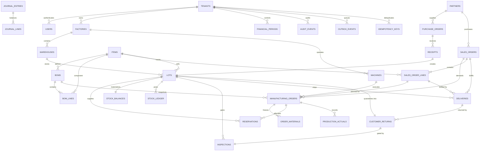

# Implemented data model

Migrations: `V1__manufacturing_core.sql`, `V2__approved_bom_integrity.sql`, `V3__sales_documents_partners_returns.sql`. Primary IDs are UUID strings except readable demonstration master IDs. Every tenant-owned table carries `tenant_id`; references use owner/id composites where operational records cross domains. Tenant-scoped document/SKU/lot/BOM revision uniqueness prevents duplicates.

### Sales documents, partners and customer returns (V3)

- `partners` gains `phone`, `billing_address`, `shipping_address`, `tax_id`, `credit_limit` (customers only, `CHECK`), `active`, `created_at`, `updated_at`. The `partner_must_be_active()` trigger (`BEFORE INSERT` on `purchase_orders`, `BEFORE INSERT OR UPDATE OF customer_id` on `sales_orders`) rejects inactive partners on new documents with SQLSTATE 23514 (HTTP 409).
- `sales_orders` is a document header: `customer_reference`, `notes`, `subtotal`/`discount_total`/`total` (maintained from the lines), `status` ∈ `DRAFT, CONFIRMED, PARTIAL, DELIVERED, CLOSED, CANCELLED` (default `DRAFT`), `status_reason` (cancel/close-short reason), `created_by`, `confirmed_by/at`, `closed_by/at`, `updated_at`. `due_date` is the required-by date. The single-item columns `product_id`, `quantity`, `unit_price`, `delivered` were removed; their values moved to line 1.
- `sales_order_lines`: `line_no` (unique per order), `product_id`, `quantity > 0`, `unit_price ≥ 0`, `discount_pct` 0–100, `line_total` (generated: `round(quantity × unit_price × (100 − discount) / 100, 6)`), `delivered ≤ quantity`, `returned ≤ delivered`. `UNIQUE(tenant_id, sales_order_id, id)` lets children prove a line belongs to their order.
- `deliveries` gains `sales_order_line_id`, `revenue_amount` and `cost_amount` (the posted revenue and COGS of that delivery), `returned ≤ quantity`, `created_by`. `manufacturing_orders` gains `sales_order_line_id`. Both use a composite foreign key `(tenant_id, sales_order_id, sales_order_line_id)` → `sales_order_lines(tenant_id, sales_order_id, id)`, so a line always belongs to the referenced order (nullable: make-to-stock orders have neither).
- `customer_returns` (posted history, `customer_returns_immutable` trigger): `number` (also the quarantine lot number and journal reference), `delivery_id`, `sales_order_id`, `sales_order_line_id`, `lot_id` (the new `QUARANTINE` lot, `source_type = 'CUSTOMER_RETURN'`), `inspection_id` (type `RETURN`), `quantity`, `unit_cost`, `cost_amount`, `credit_amount`, `reason`, `created_by`. The return status shown to users is derived from the inspection: pending → awaiting QC, passed → restocked, failed → rejected (held, value retained).
- Migration of existing data: each single-item order becomes a header plus line 1 (same product, quantity, price, delivered), header totals are computed, existing deliveries and manufacturing orders get the line id, delivery revenue is `round(quantity × price, 6)` and delivery cost is taken from the matching posted `CUSTOMER_DISPATCH` ledger row (lot unit cost as fallback). Posted ledger/journal/audit rows are untouched.
- Indexes: `sales_orders(tenant_id, created_at DESC, id DESC)` (keyset list), `(tenant_id, status, created_at DESC)`, `(tenant_id, customer_id)`; `sales_order_lines(tenant_id, product_id)`; `deliveries(tenant_id, sales_order_id, created_at)`; `customer_returns` by order and delivery; `partners(tenant_id, type, active, name)`; `manufacturing_orders(tenant_id, sales_order_line_id)`; `audit_events(tenant_id, reference, created_at)` for document activity feeds.

`lots.source_type/source_id` identify the purchase/manufacturing/opening document; genealogy follows receipt → lot → reservation/material issue → manufacturing order → finished lot → delivery → customer return → return lot. Source IDs are polymorphic application-validated references rather than cross-table foreign keys. A full recall explorer, serial tracking and expiry/FEFO are later scope.

`stock_balances` is a materialized projection maintained only by the stock-ledger trigger for quantity/value; reservation updates are transactional application commands. Reconcile `SUM(delta)`/`SUM(value_delta)` per owner/lot against balances, and active reservation totals against `reserved`. `quantity >= reserved >= 0` and nonnegative value constraints reject unauthorized negative stock.

Money/quantity precision is six decimal places (maximum 14 integer digits in the database, stricter API amount limits). UI formatting never changes stored values. SQL indexes cover owner/status/date list and allocation access. Current workspace list snapshots cap at 250 rows (BOM lines 1,000; audit 100), with pagination inside that bound. This is explicitly not the large-ledger reporting solution; replace capped lists with server cursor pagination and background export before scale.

Flyway validates checksums at startup and runs PostgreSQL transactional DDL. Never edit an applied migration. Add a new numbered migration and rehearse it against a restored backup. Posted financial and inventory rows have no delete/overwrite path. Retention/archive cutoffs, erasure handling and access to old records require an organization-approved policy and implementation before commercial data retention commitments.
